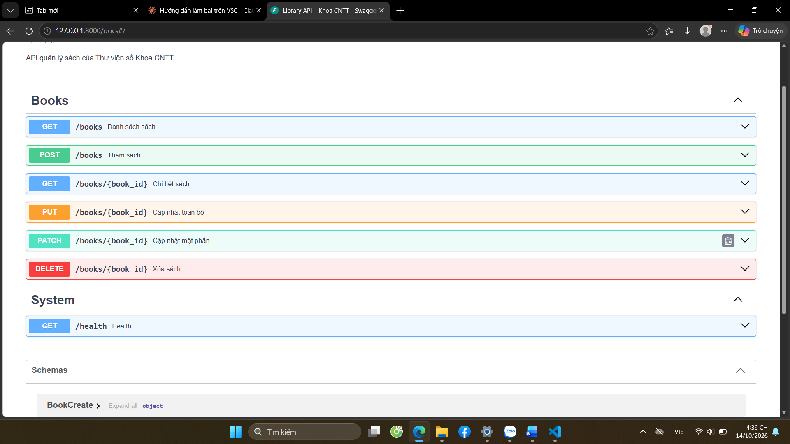
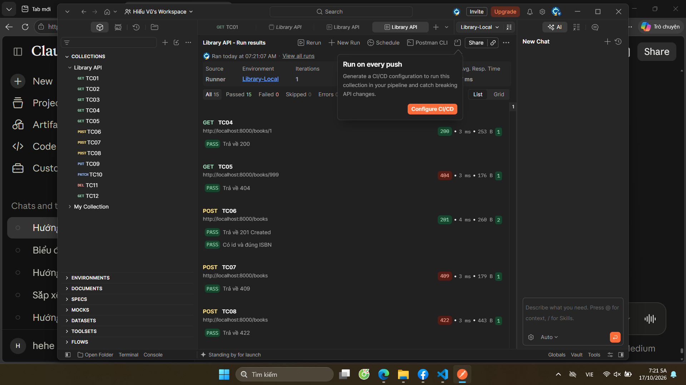

# Library API – Thư viện số Khoa CNTT

Web API quản lý sách xây dựng bằng **FastAPI**, dữ liệu lưu trong bộ nhớ.
Bài thực hành số 4 – Lập trình mã nguồn mở (POS02024).

## Case study

Thư viện Khoa CNTT quản lý sách bằng tệp Excel, tìm kiếm thủ công. Library API cung cấp
dữ liệu dạng JSON để website thư viện và ứng dụng di động cùng sử dụng: xem danh sách,
tìm theo tên/tác giả, thêm, sửa, xóa sách; mỗi ISBN là duy nhất.

## Cài đặt và chạy

```bash
git clone git@github.com:<tên-github>/library-api.git
cd library-api
python3 -m venv .venv
source .venv/bin/activate
pip install -r requirements.txt
uvicorn app.main:app --reload
```

Mở http://127.0.0.1:8000/docs để xem Swagger UI.

## Các endpoint

| Phương thức | Endpoint | Chức năng | Thành công | Lỗi |
|---|---|---|---|---|
| GET | /books | Danh sách; lọc `?q=`, `?author=`; phân trang `?skip=`, `?limit=` | 200 | 422 |
| GET | /books/{id} | Chi tiết một cuốn sách | 200 | 404 |
| POST | /books | Thêm sách mới | 201 | 409, 422 |
| PUT | /books/{id} | Cập nhật toàn bộ | 200 | 404, 409, 422 |
| PATCH | /books/{id} | Cập nhật một phần | 200 | 404, 422 |
| DELETE | /books/{id} | Xóa sách | 204 | 404 |

Ngoài ra có `GET /health` để kiểm tra server đang chạy.

## Kiểm thử bằng Postman

1. Khởi động server: `uvicorn app.main:app --reload`.
2. Import hai tệp trong thư mục `postman/`: collection `Library-API.postman_collection.json`
   và environment `Library-Local.postman_environment.json`.
3. Chọn environment **Library-Local**, chuột phải collection → **Run collection**.
4. Khởi động lại server trước mỗi lần chạy để TC07 (ISBN trùng) cho kết quả ổn định.

Chạy bằng dòng lệnh với Newman:

```bash
npx newman run postman/Library-API.postman_collection.json \
    -e postman/Library-Local.postman_environment.json
```

## Ảnh minh chứng

Swagger UI:



Kết quả Collection Runner:

